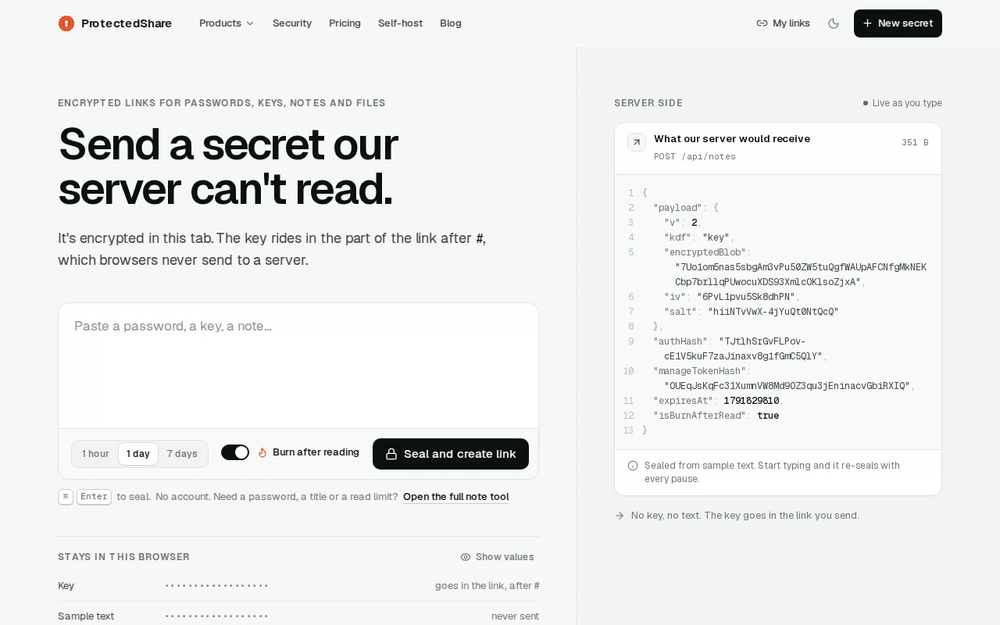

# ProtectedShare

Encrypted, expiring links for passwords, API keys, `.env` files and files. No accounts. Open source and self-hostable.

[](LICENSE)
[](https://nextjs.org)
[](https://workers.cloudflare.com)
[](https://github.com/KunalSiyag/protectedshare/actions/workflows/publish-web-image.yml)

Your browser encrypts the secret with AES-256-GCM before anything is sent. The key rides in the part of the link after `#`, which browsers don't send to servers. The server stores ciphertext and metadata such as expiry and read counts, and never receives the plaintext, the key or the password. [What's stored, and for how long](https://protectedshare.me/privacy).

**[protectedshare.me](https://protectedshare.me)** · [How the encryption works](https://protectedshare.me/security) · [Self-host it](https://protectedshare.me/self-host) · [Comparisons](https://protectedshare.me/vs)



<sub>Seal a note, open the link in another tab, reload: it burned on the first read. Recorded on a local dev server.</sub>

## What it does

| Tool | Route | What it does |
|---|---|---|
| Secure note | `/notes` | A self-destructing note behind a link, like Privnote or OneTimeSecret. Key in the link (`#k=`), a separate password, or both. Can burn after the first read. |
| EnvShare | `/secrets` | `.env` files and API keys with a read limit of 1–100. Key in the link. |
| File drop | `/files` | Up to 25 MB of files, encrypted in 1 MiB chunks, with a download limit of 1–100. File names live in an encrypted manifest. |
| Secret request | `/request` | Ask someone for a secret. Their reply is encrypted to your public key; the private key lives only in your inbox link. |
| Chat | `/chat` | Encrypted rooms with nicknames, replies, reactions, edit/delete, disappearing messages, images and files (up to 800 KB), safety words, and burn room. Messages are purged when everyone leaves. |
| Notepad | `/notepad` | Markdown notepad. Local mode keeps the encrypted vault in the browser; optional sync uploads ciphertext. Notes export as self-decrypting HTML. |
| My links | `/links` | Shares you created on this device, with status (opened, expired, revoked), reads left and revoke. Stored in this browser only. Optional browser notification (Web Push) when a link is first opened and when it's used up. |
| Share target | `/share-target` | Once installed as an app, "Share to ProtectedShare" from other apps. The shared text or files stay on the device until you seal them. |
| Claude and MCP | [`/integrations/claude`](https://protectedshare.me/integrations/claude) | Create notes, EnvShare links and secret requests, check or revoke them, and generate passwords from Claude or any MCP client. Remote connector at `https://mcp.protectedshare.me/mcp` (encrypts on our MCP Worker, key-only links), or the local server `npx protectedshare-mcp` (encrypts on your machine, adds passwords, opening links and a breach check). |

Every share expires within 30 days (1 hour, 1 day, 7 days or a custom time).

**Free tools** ([`/tools`](https://protectedshare.me/tools)): [password generator](https://protectedshare.me/tools/password-generator), [encrypt text](https://protectedshare.me/tools/encrypt-text), [secret key generator](https://protectedshare.me/tools/secret-key-generator), [password strength checker](https://protectedshare.me/tools/password-strength-checker), [breached password checker](https://protectedshare.me/tools/breached-password-checker), [JWT decoder](https://protectedshare.me/tools/jwt-decoder) and [Wi-Fi QR code generator](https://protectedshare.me/tools/wifi-qr-code-generator). They run in the browser and send nothing to our server. The breached password checker sends only the first 5 hex characters of the password's SHA-1 hash to Have I Been Pwned's range API (with `Add-Padding: true`, no cookies, no referrer), and its page alone allows `api.pwnedpasswords.com` in the Content-Security-Policy.

**Comparisons** ([`/vs`](https://protectedshare.me/vs)): how ProtectedShare differs from [Privnote](https://protectedshare.me/vs/privnote), [OneTimeSecret](https://protectedshare.me/vs/onetimesecret), [EnvShare](https://protectedshare.me/vs/envshare), [ProtectedText](https://protectedshare.me/vs/protectedtext), [Bitwarden Send](https://protectedshare.me/vs/bitwarden-send), [Yopass](https://protectedshare.me/vs/yopass), [Password Pusher](https://protectedshare.me/vs/password-pusher), [PrivateBin](https://protectedshare.me/vs/privatebin), [Firefox Send](https://protectedshare.me/vs/firefox-send) and [WeTransfer](https://protectedshare.me/vs/wetransfer). Details about other products come from their public documentation at the time of writing.

## Security model

Short version: AES-256-GCM in the browser via Web Crypto, keys in the URL fragment (which browsers don't send to servers), and the server checks a hash before releasing ciphertext. The full model is at [`/security`](https://protectedshare.me/security); what's stored and for how long is at [`/privacy`](https://protectedshare.me/privacy).

### Crypto v2 (`packages/crypto/src/v2.ts`)

- **Keys.** Link mode uses a random 32-byte key, base64url in the fragment: `/notes/{id}#k={key}`. Password mode stretches the password with PBKDF2-SHA256 at 600,000 iterations over a random 16-byte salt. `key+password` concatenates both.
- **Derivation.** HKDF-SHA256 over that input and the item's salt gives two independent values: an AES-256-GCM key (`info = "ps/v2/enc"`) and a 32-byte auth token (`info = "ps/v2/auth"`).
- **What the server gets.** Ciphertext, IV, salt, KDF mode, and `authHash = SHA-256(authToken)`. To read, the client derives the token and sends it in `X-Auth-Token`; the server hashes it and compares in constant time. A guessed id alone returns nothing.
- **Files.** Each chunk is encrypted separately with its index and the chunk count bound as AAD (`ps-chunk:{i}/{n}`), so chunks can't be reordered or dropped silently. The encrypted chunks are stored in R2 under `drops/{id}/{idx}` (D1 keeps each chunk's size; without an R2 binding they stay in D1). The server counts a download when it starts (`POST /api/drops/:id/start` decrements the count atomically and opens a 60-minute download session); chunk reads need that session's `X-Download-Token`.
- **Secret requests.** ECDH P-256 + HKDF-SHA256 + AES-256-GCM with an ephemeral sender key. The inbox token is derived from the private key. Only a holder of the full sender link (`#k=`) can answer: replying needs a respond token derived from that key, and the sender's browser checks the public key against a SHA-256 fingerprint carried inside the encrypted label before sending.
- **Chat.** Room keys come from the invite fragment (`/chat#r={room}&k={key}`) or a room password. Members see five safety words derived from the key to confirm they share the same room.
- **Receipts.** Creating a share can register a random manage token; the server stores only its hash plus status, counts and timestamps (never content). My links keeps the token and sends it only to show "opened", to revoke, and to switch read notifications on or off.
- **Read notifications.** Optional Web Push per link (`src/lib/webpush.ts`: RFC 8291 encryption and RFC 8292 VAPID on WebCrypto, no dependency). The server keeps each watching browser's push endpoint, `p256dh` key and auth secret (at most 5 per link, allow-listed push services only) and sends `{ kind, id, event, at }`, padded to 128 bytes, with a TTL of one day, on the first open and on the read that uses the link up. A subscription is deleted after that last push, on revoke or takedown, when the push service answers 404/410, and by the cron once the link expires. In the browser, `public/sw.js` is registered only when you turn notifications on, or by the installed app; it is scoped to `/share-target/`, caches nothing, and reads labels from IndexedDB `ps-notify` (kind, id, label, expiry; never the URL, key or manage token).
- **Rate limits.** Workers Rate Limiting bindings, all optional: wrong keys or passwords (10 a minute per share, room or notepad), room joins (30) and chat messages (120) per room, answers per request (10), reports per link (5, which also caps report emails at 5 a minute per Cloudflare location), and creates per client IP (600, IPv6 grouped by /64; the IP goes to the limiter only, never to D1). On the hosted site browsers call the Worker directly, so that is the visitor's address; requests relayed through a web host carry its shared IP (see [Deployment](#api-cloudflare-workers--d1)). Password-protected targets lock for 10 minutes in `auth_lockouts` (key and end time only).
- **Ids.** New note and EnvShare ids are 10 random characters (v1 links have 5). The id is in the path, so the server sees it; the key never is.

### Legacy v1 links

Links made before v2 keep working. They use PBKDF2 (210,000 iterations) for the encryption key and a separate password proof (PBKDF2 at 100,000 iterations with a fixed salt, then SHA-256) that the server checks. Synced notepad workspaces still authenticate with that proof and store usernames as SHA-256 hashes.

### Honest limits

- This is a web app, so you trust the JavaScript the site serves each time you load it. A compromised server could send modified code that reads what you type. Every in-browser encryption tool has this limit; the code is open source, and self-hosting takes our server out of that trust.
- The server sees request metadata: share ids, sizes, counts, timestamps. On the hosted site the browser calls the Worker directly (`NEXT_PUBLIC_API_ORIGIN=https://api.protectedshare.me`), so Cloudflare sees IP addresses, request metadata and ciphertext in transit and the web host sees page loads; without that setting the web app relays `/api/*` to the Worker and its host sees API calls too; Workers observability logs are enabled in `wrangler.toml`.
- A weak password is still weak. Wrong keys and passwords are rate limited per share (Workers Rate Limiting, 10 a minute, counted per Cloudflare location, so approximate), and a password-protected share, chat room or notepad locks for 10 minutes once it's over that limit. That slows online guessing; it doesn't stop someone with a copy of the database from guessing offline at 600,000 PBKDF2 rounds per guess. While locked, even the right password is refused, so anyone who knows the id can keep it shut for 10 minutes at a time. Key-only links never lock. Prefer link-key or link+password mode.
- Pages send a Content-Security-Policy (same-origin scripts, connections and images, `frame-ancestors 'none'`). It keeps `'unsafe-inline'` for scripts because the Next.js bootstrap is inline without nonces, so it limits where data can be sent rather than stopping inline script.
- Anyone with a full link can open it until it expires or runs out of reads. Links you created are saved in your browser's localStorage (My links), keys included.
- Google Analytics loads only if `NEXT_PUBLIC_GA_ID` is set at build time; it sets its own cookies when it does. Cloudflare Web Analytics loads only if `NEXT_PUBLIC_CF_BEACON_TOKEN` is set; it's cookieless, strips the query and fragment itself, and counts full page loads only. Neither loads on pages that open or hold a share (note/secret/file/request links, chat, My links, notepad, share target), whose Content-Security-Policy leaves the analytics hosts out, and GA reports the path only, never the query or fragment. The app itself sets no cookies.
- Read notifications go through the browser's push service (Google, Mozilla, Apple or Microsoft). It can't read them, but it sees when one is sent.
- Sharing into the installed app stays on the device only once the service worker is running (the installed app registers it on first launch). Before that, the share's `POST` reaches the web host, whose handler redirects without reading or logging the body. Any website can post to the share target too, so `/share-target` first shows what arrived and passes nothing to a composer or to File drop until you click to continue.
- The contact form is not end-to-end encrypted; it stores name, email, company and message. Abuse reports store the link's kind and id, a reason, and any details and email the reporter adds, for 180 days; both are emailed through Resend to `NOTIFY_EMAIL_TO` (default admin@protectedshare.me) when `RESEND_API_KEY` is set.
- The remote MCP connector necessarily sees plaintext: it encrypts what a tool receives in the Worker's memory (over TLS from the MCP client), then sends the storage API ciphertext and hashes to create a link, and a link's kind, id and manage token to check or revoke it, over a Service Binding. It stores nothing and never logs arguments, results or bodies. For end-to-end encryption from Claude, use the local server, which encrypts on your machine. Either way, the MCP client and its AI provider see the conversation, including the text you ask it to share and the links, keys and manage tokens the tools return.
- No independent security audit has been published.

## Architecture

```
apps/
  web/        Next.js 15 App Router, React 19, Tailwind 3.4. The website encrypts here, in the browser.
              /api/* is proxied to the Worker (API_BACKEND_URL).
  api/        Hono on Cloudflare Workers + D1 (file-drop chunks in R2 when a bucket is bound).
              Stores ciphertext, verifier hashes, receipts.
              Routes in src/routes (shares, drops, requests, manage, chat, stats, reports, notify),
              helpers in src/lib.
              A cron (*/30 * * * *) purges expired rows.
  mcp/        Remote MCP server: Cloudflare Worker protectedshare-mcp at mcp.protectedshare.me/mcp.
              Stateless Streamable HTTP; encrypts in memory, calls the API over a Service Binding.
packages/
  crypto/     Web Crypto wrappers: v1 (legacy) and v2 (src/v2.ts).
  contracts/  Zod schemas and TypeScript types for every API payload.
  ui/         Shared React primitives (Button, Field, Panel, StatusChip, ...).
  formatting/ Small string helpers.
  mcp-core/   MCP tool definitions and handlers shared by both MCP servers ("remote" and "local" modes).
  mcp-server/ The protectedshare-mcp package: the local stdio MCP server (npx protectedshare-mcp).
```

Retention, enforced on read and by the cron: notes and secrets are deleted on their last allowed read or at expiry; file drops (D1 rows and R2 objects) after their last download, on revoke or takedown, or at expiry (unfinished uploads after 6 hours; the cron also sweeps orphaned R2 chunks); download sessions after 60 minutes or when the download finishes; secret requests when the inbox collects the reply; chat messages when the room empties, on their disappearing timer, or when the room is burned; receipts 30 days after the share's expiry; notification subscriptions when the share is used up, revoked or expired; lockouts when their 10 minutes are up; abuse reports after 180 days; daily usage counts (`usage_daily`: day, kind, count, no ids) after 400 days.

## Local development

Requires Node.js 22+ and npm 10+.

```bash
git clone https://github.com/KunalSiyag/protectedshare.git
cd protectedshare
npm install

# Create the local D1 database with the full v2 schema
cd apps/api
npx wrangler d1 execute protectedshare --local --file=schema.sql
cd ../..

# Point the web app at the local API (otherwise it proxies to the hosted API)
echo "API_BACKEND_URL=http://localhost:8787" > apps/web/.env.local

# In two terminals (a third for the optional MCP server)
npm run dev:api   # http://localhost:8787
npm run dev:web   # http://localhost:3000
npm run dev:mcp   # http://localhost:8790/mcp
```

`npm run typecheck` checks every workspace.

### Schema and migrations

`apps/api/schema.sql` is the complete current schema (it includes everything in migrations 0001–0009). Use it for new databases. For an existing database, apply the migrations in `apps/api/migrations/` that it hasn't seen, in order; `0005_v2.sql` adds receipts, file drops, secret requests, chat rooms and the v2 columns, `0006_security.sql` adds file-drop download sessions and the secret-request respond hash, `0007_r2_limits_stats_reports.sql` adds usage counters, abuse reports, auth lockouts and a chunk-size column, `0008_push.sql` adds read-notification subscriptions, and `0009_drop_budget.sql` adds the file-drop spending guard (a storage total and daily R2 operation counts). A "duplicate column" error from one of their `ALTER TABLE` lines means that column already exists. The Worker also creates missing tables and columns at runtime (`src/lib/schema.ts`).

## Deployment

### API (Cloudflare Workers + D1)

```bash
cd apps/api
npx wrangler d1 create protectedshare            # put the database_id into wrangler.toml
npx wrangler r2 bucket create protectedshare-drops   # file-drop chunks; or delete the [[r2_buckets]] block to keep them in D1
npx wrangler d1 execute protectedshare --remote --file=schema.sql
npx wrangler deploy                              # also registers the */30 cleanup cron
```

The bucket must exist before `wrangler deploy`, or the deploy fails. A lifecycle rule is recommended as a backstop for anything a delete missed: the cron also sweeps orphaned chunks every 30 minutes, but each run scans only the first ~10,000 drop prefixes. `npx wrangler r2 bucket lifecycle add protectedshare-drops expire-old-drops drops/ --expire-days 31`.

R2 bills any usage past its monthly free allowance (10 GB-month stored, 1 million Class A writes, 10 million Class B reads), rounded up to a whole unit, and Cloudflare has no hard spending cap. So the API caps file drops itself, with `[vars]` in `wrangler.toml`: `DROP_STORAGE_LIMIT_GB` (default 9), `R2_CLASS_A_DAILY_LIMIT` (30,000 writes per UTC day) and `R2_CLASS_B_DAILY_LIMIT` (300,000 reads per UTC day). At a cap it refuses new uploads or downloads with 503 `DROP_CAPACITY` and a `Retry-After`, instead of billing. The defaults stay inside the free allowance for a whole month; the allowance is per Cloudflare account, so lower them if other projects there use R2, and raising them can cost money. On the Workers Free plan, Workers and D1 refuse requests past their daily limits rather than bill, which leaves R2 as the only usage-billed part of the API.

`wrangler.toml` also declares six optional rate limiters (`RL_AUTH`, `RL_CLAIM`, `RL_RESPOND`, `RL_CHAT_POST`, `RL_REPORT`, `RL_CREATE`) with `namespace_id` 71001–71006. Each id must be unique within your Cloudflare account; delete a block to skip that check. `RL_CREATE` counts creates per client IP (600 a minute). The hosted site's browsers call the Worker directly at `api.protectedshare.me` (the `routes` custom domain in `wrangler.toml`), so that is the visitor's address; requests relayed through a web host carry the host's shared IP. That is why the limit is high, and its trade-off: one client that reaches it through a relay holds up creates for everyone else on that address until the minute is up. If you self-host the web app with its built-in `/api` proxy instead, every request arrives from your server's IP and `RL_CREATE` becomes a site-wide cap: raise it or delete it.

Optional Worker secrets (`npx wrangler secret put <NAME>`) and email settings (the two `NOTIFY_EMAIL_*` values aren't secret, so a `[vars]` entry in `wrangler.toml` works too):

| Secret | Purpose |
|---|---|
| `RESEND_API_KEY` | Email contact-form messages and abuse reports through Resend, to `NOTIFY_EMAIL_TO` from `NOTIFY_EMAIL_DOMAIN`. Without the key, both are only stored in D1. |
| `NOTIFY_EMAIL_TO` | Where those emails go. Default `admin@protectedshare.me`. |
| `NOTIFY_EMAIL_DOMAIN` | The domain they're sent from (`deals@` for contact messages, `reports@` for reports). Default `protectedshare.me`. It must be a domain verified in your Resend account. |
| `ADMIN_TOKEN` | At least 32 characters. Turns on `DELETE /api/admin/:kind/:id` (header `X-Admin-Token`) for takedowns: deletes the content and any R2 chunks and marks the receipt revoked. Unset or shorter, the route answers 404. |
| `VAPID_PUBLIC_KEY`, `VAPID_PRIVATE_KEY`, `VAPID_SUBJECT` | Read notifications. Generate the pair with `npm run vapid:generate -w @protectedshare/api` (prints to the terminal, writes nothing); the subject is a `mailto:` or `https:` contact. Without all three, `POST /api/manage/:kind/:id/watch` answers 503. Rotating the keys ends existing subscriptions. |

The `deploy-api.yml` workflow deploys on pushes to `main` that touch the API when `CLOUDFLARE_API_TOKEN` and `CLOUDFLARE_ACCOUNT_ID` are set as repository secrets. It does not run migrations or create the R2 bucket.

### Web app

Deploy `apps/web` to any Next.js host, or use the container image that `publish-web-image.yml` pushes to GitHub Container Registry:

```bash
docker pull ghcr.io/kunalsiyag/protectedshare-web:latest
docker run --rm -p 3000:3000 \
  -e API_BACKEND_URL=https://your-api.example.workers.dev \
  ghcr.io/kunalsiyag/protectedshare-web:latest
```

| Variable | When | Purpose |
|---|---|---|
| `API_BACKEND_URL` | runtime | Your Worker's URL. Without it, the proxy falls back to the hosted API. |
| `NEXT_PUBLIC_GA_ID` | build time, optional | Google Analytics. Leave unset to ship without it. |
| `NEXT_PUBLIC_CF_BEACON_TOKEN` | build time, optional | Cloudflare Web Analytics (cookieless). Leave unset to ship without it. |
| `NEXT_PUBLIC_VAPID_PUBLIC_KEY` | build time, optional | The Worker's `VAPID_PUBLIC_KEY`. Without it, read notifications are off. |
| `NEXT_PUBLIC_GOOGLE_SITE_VERIFICATION` | build time, optional | Google Search Console verification meta tag. |
| `NEXT_PUBLIC_API_ORIGIN` | build time, optional | The API Worker's own origin, e.g. `https://api.protectedshare.me`. Browsers then call it directly (it's added to the CSP), so API traffic, file-drop chunks included, never passes through the web host. Unset, the app relays `/api` to `API_BACKEND_URL`. |

`NEXT_PUBLIC_*` values are baked in when the app is built. The published image is built with none of them, so it has no analytics and no read notifications; to set them, build your own image with the values in `apps/web/.env.production`, or deploy `apps/web` to a Next.js host that sets them at build time. On Vercel, `apps/web/vercel.json` rewrites `/api` to protectedshare.me's API Worker, for pages built without `NEXT_PUBLIC_API_ORIGIN`: point that rewrite at your own Worker, or delete the file to use the built-in proxy. Relayed API traffic counts against the host's bandwidth, so `NEXT_PUBLIC_API_ORIGIN` is the better choice.

More detail: [protectedshare.me/self-host](https://protectedshare.me/self-host).

### MCP server (optional)

The remote connector is a second Worker, `apps/mcp` (`protectedshare-mcp`):

```bash
cd apps/mcp
npx wrangler deploy
```

Before deploying, edit `apps/mcp/wrangler.toml`: delete the `routes` block (it claims `mcp.protectedshare.me` as a custom domain, which needs that zone in your account) and use the workers.dev URL or your own domain; set `SITE_URL` to your web app; keep the `[[services]]` binding only if your API Worker is `protectedshare-api` in the same account, otherwise delete it and set `API_BASE_URL` (with neither, it calls protectedshare.me's API). `ALLOWED_ORIGINS` lists the hostnames allowed in an `Origin` header besides localhost (default `claude.ai,claude.com`). The optional limiters `RL_MCP` (600 requests a minute per connecting IP, `namespace_id` 71101) and `RL_MCP_CREATE` (120 calls a minute per connecting IP to the tools that create links, `namespace_id` 71102) group IPv6 addresses by /64 and must not clash with other limiters in your account. It takes one JSON-RPC message per request and refuses batches. The Worker stores nothing and logs only request metadata. Local development: `npm run dev:mcp` (http://localhost:8790/mcp, against the local API).

The local server needs no deploy: `npx protectedshare-mcp`, pointed at your instance with `PROTECTEDSHARE_API_URL` (https, except for localhost) and, for the breach check, optionally `PROTECTEDSHARE_HIBP_URL`. See [`packages/mcp-server/README.md`](packages/mcp-server/README.md).

## Feedback and security reports

Bugs, questions and ideas: [GitHub issues](https://github.com/KunalSiyag/protectedshare/issues). If you find a vulnerability, email admin@protectedshare.me with steps to reproduce, and give us a chance to fix it before publishing ([details](https://protectedshare.me/security)).

## License

[MIT](LICENSE).
